  I am <b>Oktova Yoga Praditia Samosir</b>, a <b>Data Analyst</b> and <b>Fullstack Developer</b> from Balige, North Sumatra. An Information Technology student at Del Institute of Technology with expertise in web development, mobile applications (iOS & Android), as well as data science & artificial intelligence.

---

##  Pac-Man Contribution Graph

  <picture>
    <source media="(prefers-color-scheme: dark)" srcset="./pacman-contribution-graph-dark.svg">
    <source media="(prefers-color-scheme: light)" srcset="./pacman-contribution-graph.svg">
    
  </picture>

##  GitHub Statistics

<table width="100%">
  <tr>
    <td width="50%" align="center">
      
    </td>
    <td width="50%" align="center">
      
    </td>
  </tr>
</table>

  

##  Skills & Abilities

### Core Tech Stacks

### Other Tech Stacks

### Tools

---

  

  
  
  
  
  
  

---

